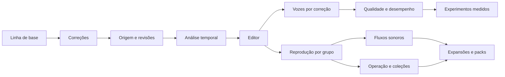

# Soundboard AI — plano de implementação consolidado por etapas

> **For agentic workers:** REQUIRED SUB-SKILL: Use superpowers:executing-plans to implement this plan task-by-task. Steps use checkbox (`- [ ]`) syntax for tracking. Delegação exige autorização aplicável; não é necessária para seguir este plano.

**Goal:** reduzir o trabalho de preparar clipes, melhorar transcrição e identificação local de vozes e permitir diálogos sonoros sequenciais/paralelos, preservando originais e mantendo operação rápida para memes e previsível para uso profissional.

**Architecture:** preservar o app Python/pywebview e o mixer existente. Introduzir origem e revisões de edição, análise temporal versionada, referências vocais rastreáveis e executor de sequências no backend. UI, atalhos e fluxos usam os mesmos contratos de reprodução, com isolamento por grupo e cancelamento explícito.

**Tech Stack:** Python 3.13 no ambiente atual, NumPy, soundfile, FFmpeg quando disponível, faster-whisper, sherpa-onnx, sounddevice/PyAudioWPatch, pywebview, JavaScript/CSS, pytest e testes JavaScript via Node.

**Data:** 29/10/2026; encerramento E0–E10 em 01/11/2026. **Estado:** implementação concluída e revisada no escopo funcional/sintético; E11 condicional. Ver [entrega](../../validation/2026-11-01-entrega-evolucao.md) e [registro de execução](../../validation/2026-10-29-execution.md). Os caminhos abaixo são relativos à raiz do projeto, atualmente `C:\Users\Hylex\.codex\worktrees\soundboard-evolution\soundboard-ai`. A integração de `main` está registrada em `4deb17d`; o checkout pessoal em D: permanece separado.

---

## 1. Decisões consolidadas

1. A captura em segundo plano já atende ao usuário. Não criar uma nova caixa de entrada nem refazer captura como condição para entregar o editor.
2. Priorizar transcrição, cortes nas pontas e internos, junção, seleção por texto e redução de reatribuições de pessoas.
3. Preservar origens e correções manuais. Resultado automático nunca é autorização para substituir campos corrigidos ou treinar uma voz.
4. Aprender referências vocais a partir de confirmações do usuário, sem retreinar a rede neural a cada edição.
5. Fluxos sonoros são parte do escopo principal: sequência, espera, paralelismo e acionamento manual, com ajustes locais por ocorrência.
6. Reaproveitar recursos existentes: replay, waveform, loop, monitor, cabo virtual, ducking, mixer, cache de áudio e packs.
7. Manter processamento local. Comparar qualidade e recursos antes de trocar modelos padrão; não executar downloads ou enviar gravações a serviços externos como efeito implícito do plano.
8. Não migrar para SQLite, trocar a stack ou reescrever toda a interface sem um requisito demonstrado.
9. Recursos de operação profissional e diversão ampliada entram após a base principal, sem desaparecer do plano.
10. Este documento define ordem, contratos e lotes entregáveis. Os documentos de design detalham a experiência; divergências de prioridade são resolvidas por este plano consolidado.

## 2. Prioridades e marcos

**P0:** correções e capacidades centrais pedidas. **P1:** qualidade medida e operação cotidiana/profissional. **P2:** expansão de formatos, diversão e compartilhamento. **P3:** experimentos dependentes de evidência.

| Etapa | Prioridade | Entrega utilizável | Dependências obrigatórias |
|---|---|---|---|
| E0 | P0 | Linha de base, isolamento dos testes e preservação do trabalho existente | Nenhuma |
| E1 | P0 | Conversão de áudio correta, erros visíveis e cadastro de voz respeitando o corte atual | E0 |
| E2 | P0 | Origem preservada, revisões de montagem e proveniência de correções | E1 |
| E3 | P0 | Transcrição temporal e trabalhos de análise independentes | E2 |
| E4 | P0 | Editor completo: texto + waveform + cortes internos + junção | E2, E3 |
| E5 | P0 | Aprendizado de vozes pelas correções e tratamento de dúvida | E2, E3, E4 |
| E6 | P1 | Qualidade local calibrada, cache por etapa e controle de recursos | E3, E4, E5 |
| E7 | P0 | Reprodução por grupo, término com motivo e agendamento comum | E2, E4 |
| E8 | P0 | Fluxos sonoros completos, editáveis e disparáveis | E7 |
| E9 | P1 | Preparar/Tocar, coleções, regras de disparo e ensaio | E4, E7 |
| E10 | P2 | Aleatoriedade, variantes, importação ampliada e packs de coleções/fluxos | Dependências por lote, abaixo |
| E11 | P3 | Experimentos: busca semântica, modelos alternativos e controles externos | Critérios específicos, abaixo |

**Ordem recomendada de execução:** E0 → E1 → E2 → E3 → E4 → E5 → E7 → E8 → E6 → E9 → E10. E11 só entra quando seu critério de entrada for atendido.

E6 tem numeração temática, mas não bloqueia E7/E8. Melhorias de qualidade devem ser medidas desde E3/E5; a comparação extensa e o ajuste fino de recursos não impedem entregar os fluxos. E9 pode ser antecipada depois de E7 se organização da biblioteca virar o principal atrito.



| Marco | Conteúdo | Demonstração de saída |
|---|---|---|
| M1 — menos trabalho manual | E0–E5 | Capturar, selecionar texto, retirar o meio, unir, corrigir pessoa e reutilizar referência confirmada |
| M2 — diálogos compostos | E7–E8 | Pergunta → espera → resposta e risada juntas → acionamento manual → conclusão |
| M3 — uso diário confiável | E6, E9 | Reconhecimento avaliado, análises controladas, coleção estável e ensaio isolado |
| M4 — expansão | E10; E11 seletivamente | Variações, grupos aleatórios, importação/compartilhamento completos e integrações justificadas |

## 3. Estado inicial e limites de execução

O schema atual é `CURRENT_SCHEMA_VERSION = 1`. Há alterações locais preexistentes em `audio_engine.py`, `main.py`, `mixer.py`, `ui/app.js`, `tests/test_api_state.py`, `tests/test_audio_engine.py`, `tests/test_e_mixer.py` e `uv.lock`. A inspeção encontrou 512 inserções e 64 remoções nesses oito arquivos; esse número é um retrato desta elaboração, não uma condição a manter.

- Não resetar, descartar ou atribuir ao plano essas alterações existentes.
- Antes de implementar, revisar os diffs e registrar o estado de partida. Um checkout isolado precisa incluir deliberadamente o estado relevante; partir só de HEAD perderia trabalho atual do mixer.
- Usar diretório de dados de teste e fixtures sintéticas. Não migrar, apagar ou reorganizar a biblioteca real durante os testes.
- Não misturar commits de alterações preexistentes com entregas do plano. Decisões de staging/commit seguem a autorização vigente na execução; nenhum commit foi feito no planejamento.
- Os comandos de validação abaixo são instruções futuras. A suíte completa não foi executada para produzir este documento.

## 4. Limites de módulos e contratos compartilhados

Durante o início da execução, a [revisão de arquitetura por Astra](../../validation/2026-10-29-architecture-review.md) fechou os contratos de identidade, migração, purge, ganho, packs, concorrência e finalização. Suas decisões complementam C1–C4 e são critérios obrigatórios nas etapas correspondentes.

Não mover arquivos existentes apenas para reorganizar. Novos módulos isolam responsabilidades; `main.py` continua como fachada da API, e `ui/app.js` como integração com a aplicação existente.

| Arquivo novo proposto | Responsabilidade | Consumidores principais |
|---|---|---|
| `audio_processing.py` | Reamostragem filtrada, normalização de canais e recortes de amostras | Análise, reprodução e cadastro de voz |
| `clip_edits.py` | Intervalos, revisão de montagem, mapas origem/resultado e validação | Editor, renderização, vozes, fluxos |
| `clip_renderer.py` | Montar PCM e derivados usando uma revisão e ajustes locais | Preview, reprodução, loudness, exportação |
| `analysis_jobs.py` | Fila limitada, prioridades, estados, cancelamento e revisões | API e etapas locais de IA |
| `transcript_model.py` | Palavras/segmentos temporais, correções e projeção na montagem | Editor e análise |
| `analysis_cache.py` | Identidade de resultados e invalidação por etapa | Trabalhos locais |
| `voice_profiles.py` | Amostras confirmadas, perfis, versões, exclusão e migração legada | Correções e cadastro explícito |
| `speaker_matching.py` | Pontuação, margem, abstenção e associação local/global | Diarização e reavaliação |
| `sound_sequences.py` | Schema de blocos, referências e validação estrutural | Editor de sequências e packs |
| `sequence_runner.py` | Execução, barreiras paralelas, esperas, avanço e cancelamento | API e atalhos |
| `collections.py` | Coleções, posições, atalhos e grupos de escolha | Área Tocar e packs |
| `ui/editor.js` | Estado/interação do editor sem duplicar áudio no frontend | `ui/app.js` |
| `ui/transcript.js` | Seleção temporal, correções e destaque textual | Editor |
| `ui/voice-profiles.js` | Perfil, amostras e correções de pessoas | Editor e configurações |
| `ui/sequences.js` | Composição de blocos e visualização da execução | Área Preparar e Tocar |
| `ui/collections.js` | Superfície de disparo, organização e sequência manual | Área Tocar |

Os nomes são o mapa de trabalho proposto. Dependências de terceiros novas só entram com necessidade demonstrada; não criar frameworks internos de plugins, filas distribuídas ou serviços adicionais.

### C1 — origem, revisão e montagem

`source_id` identifica o áudio preservado; `clip_id` identifica o clipe da biblioteca; `revision_id` identifica uma revisão imutável. Uma montagem contém intervalos ordenados `[start_sample, end_sample)`, definidos sobre PCM canônico a 48 kHz. Tempos de reconhecimento a 16 kHz são convertidos explicitamente para esse referencial.

```json
{
  "clip_id": "clip-a",
  "revision_id": "rev-2",
  "source_id": "source-a",
  "sample_rate": 48000,
  "spans": [[0, 96000], [192000, 288000]],
  "gain_db": 0.0
}
```

O exemplo mantém 0–2 s e 4–6 s, produzindo quatro segundos. A primeira versão mantém ordem cronológica e não repete intervalos dentro de uma montagem. Repetir um clipe em uma sequência é permitido e cria outra ocorrência.

Contrato de módulo: `validate_spans(spans, total_samples)` rejeita intervalos vazios, negativos, fora da origem, desordenados e sobrepostos; `output_to_source_sample(spans, output_sample)` mapeia posição no resultado para a origem e rejeita posição fora do resultado.

### C2 — análise temporal e correções

Um resultado registra `analysis_id`, `source_id`, intervalo, modelo/versão, parâmetros, revisão solicitante e `status`. Estados: `queued`, `running`, `ready`, `no_speech`, `failed`, `cancelled`. Erro inclui código e mensagem; indisponibilidade de modelo nunca equivale automaticamente a ausência de fala.

Palavras contêm identidade estável na versão da análise, texto reconhecido e limites na origem. Correção manual guarda texto próprio e âncora; unir/dividir palavras ancora o bloco inteiro até realinhamento. Não inventar timestamps proporcionais ao número de caracteres.

Resultado só é aplicado automaticamente se a revisão de entrada continuar atual e os campos não tiverem sido corrigidos manualmente. Caso contrário, fica disponível como proposta ou é descartado como obsoleto.

### C3 — amostra vocal confirmada

Cada exemplo registra `sample_id`, `speaker_id`, `source_id`, intervalos, ação manual de origem, versão do extrator, indicadores de qualidade e estado de elegibilidade. Chave de deduplicação inclui origem, intervalos e versão do extrator. Cada perfil tem `profile_version`; apagar exemplo refaz a agregação e invalida correspondências dependentes.

Uma identidade local à captura não é uma identidade global de pessoa. Similaridade é escore, não porcentagem de certeza. Atribuição manual e atualização do perfil têm resultados separados.

### C4 — execução sonora

`play_id` identifica uma reprodução; `group_id` identifica seu dono. Finalização contém motivo `completed`, `cancelled` ou `failed`. `execution_id` identifica uma execução congelada de sequência. Uma ocorrência referencia `clip_id` e `revision_id`, com ajustes próprios.

`Stop All` cancela execuções e esperas antes de parar sessões. Um callback obsoleto nunca inicia uma nova etapa. Paralelismo usa um ponto comum do mixer por saída, sem promessa de sincronização física perfeita entre dispositivos diferentes.

## 5. Método de execução por lote

Cada lote abaixo segue o ciclo: teste comportamental que falha → execução focada mostrando a falha esperada → implementação mínima → teste focado verde → regressões afetadas → demonstração da entrega. Não considerar falha de ambiente ou import acidental como demonstração suficiente do comportamento vermelho.

Os testes novos nomeados nos comandos são arquivos a criar na etapa correspondente. Não executar comandos de uma etapa futura antes de existir seu conjunto de testes. Para mudanças de UI, extrair lógica pura testável em Node e complementar com teste visual/manual; teste de funções JavaScript não comprova integração do WebView.

## E0 — linha de base e ambiente de avaliação

**Arquivos existentes:** `pyproject.toml`, `README.md`, `tests/`, diffs locais listados na seção 3.
**Criar:** `docs/validation/2026-10-29-baseline.md` durante a execução; `tools/evaluate_audio_pipeline.py` e `tests/test_evaluation_metrics.py` em E6, não antecipadamente.

- [x] E0.1 Registrar HEAD, arquivos modificados e quais mudanças locais precisam ser preservadas; revisar especialmente mixer, cache e API.
- [x] E0.2 Rodar baseline Python e busca JS; registrar separadamente falhas anteriores, falhas ambientais e resultado efetivo.
- [x] E0.3 Definir diretório temporário de dados para testes e snapshots de migração; impedir uso acidental de `data/` real nas fixtures.
- [x] E0.4 Definir protocolo de avaliação com capturas/sessões separadas entre cadastro, calibração e teste. Usar amostras reais selecionadas pelo usuário para resultados perceptivos; enquanto não houver corpus, seguir com testes sintéticos sem alegar ganho de IA.

```powershell
.\.venv\Scripts\python.exe -m pytest -q
node --test tests/test_fuzzy.test.cjs
```

**Saída:** baseline rastreável e dados isolados. Nenhuma estimativa de melhora deriva apenas da ausência de falhas unitárias.

## E1 — correções de confiabilidade com efeito imediato

**Modificar:** `ai_analyzer.py:374`, `audio_engine.py:364`, `main.py:660`, `main.py:783`, `main.py:941`, `ui/app.js` nos handlers de importação/cadastro, `doctor.py`, `pyproject.toml` e `uv.lock`.
**Criar:** `audio_processing.py`, `tests/test_audio_processing.py`, `tests/test_analysis_status.py`, `tests/test_voice_enrollment.py`, `tests/test_import_results.py`.

- [x] E1.1 Reproduzir aliasing com seno acima da banda e substituir interpolação linear por `scipy.signal.resample_poly`, com fatores reduzidos pelo máximo divisor comum das taxas. Adicionar SciPy como dependência direta e resolver/validar o lock no Python suportado. FFmpeg continua necessário apenas para formatos que exigem seu decodificador; conversão dos formatos nativos não passa a depender dele.
- [x] E1.2 Testar duração, canais, preservação de frequências dentro da banda e atenuação fora dela. Reutilizar conversão entre reprodução e análise, com taxas de saída explícitas.
- [x] E1.3 Separar falha de modelo, falha de áudio e ausência de fala; não classificar automaticamente como Vinhetas quando a análise falhou.
- [x] E1.4 Fazer cadastro explícito de voz aplicar o trim atual e exigir pessoa escolhida. Separar “pessoa corrigida” de “amostra cadastrada”, sem esconder falha de extração.
- [x] E1.5 Isolar falhas por arquivo na importação comum; retornar sucesso/falha/aviso por item, limpar cópias órfãs do item malsucedido e mostrar o resumo na UI. Não alterar arquivos anteriores já importados com sucesso.
- [x] E1.6 Tornar o modo de importação explícito, sem depender implicitamente do filtro ativo. Preservar as ações existentes durante a transição.

```powershell
.\.venv\Scripts\python.exe -m pytest tests/test_audio_processing.py tests/test_analysis_status.py tests/test_voice_enrollment.py tests/test_import_results.py tests/test_audio_engine.py tests/test_taxonomy_and_decision_tree.py -q
```

**Aceite:** amostra de 12 kHz não reaparece fortemente em 4 kHz ao converter 48→16 kHz; cadastrar voz usa apenas o corte; erro em um arquivo não impede os demais; falha de IA fica visível. A correção espectral precisa de limiar de atenuação documentado pelo reamostrador escolhido, além da preservação do tom de controle.

## E2 — origem, revisões e persistência compatível

**Modificar:** `store.py` na migração/aplicação do schema, exclusão/restauração/purga; `main.py` ao salvar/reproduzir; `packs.py` para preservar compatibilidade.
**Criar:** `clip_edits.py`, `clip_renderer.py`, `tests/test_clip_edits.py`, `tests/test_clip_renderer.py`, `tests/test_edit_persistence.py`.

- [x] E2.1 Introduzir schema v2 com migração explícita de v1: origem preservada, revisão inicial equivalente ao trim legado e proveniência desconhecida para campos históricos. Não marcar rótulo antigo como confirmação humana.
- [x] E2.2 Implementar os contratos C1, criação de revisão imutável e mapas origem/resultado. Renderização única alimenta preview, reprodução, waveform e medidas.
- [x] E2.2a Corrigir identidade no store: um `clip_id` explícito diferente nunca é unido a outro clipe só por compartilhar `file_path`. Deduplicação de conteúdo pertence à origem/importação; duas montagens da mesma origem continuam sendo clipes independentes. Testar ambos os casos e preservar comportamento legado apenas quando a entrada não identifica uma montagem independente.
- [x] E2.3 Garantir gravação consistente e backup de migração; falha mantém dados anteriores e alterações disponíveis para repetir salvamento.
- [x] E2.4 Atualizar referência/exclusão: origem usada por outra revisão, amostra vocal ou sequência não pode ser removida incidentalmente. Regras da purga de replay temporário continuam restritas a rascunhos temporários.
- [x] E2.5 Persistir edição em andamento ao entrar no editor, separando-a dos drafts de captura que a regra antiga purga no boot. Reabrir recupera a edição e permite descartar explicitamente.
- [x] E2.5a Armazenar fontes e derivados duráveis fora de `tmp`: o purge existente varre todo esse diretório, não apenas clipes com flag `pending`. Testar boot/purge com referências de montagem, edição e amostra vocal; exclusão depende de alcançabilidade, não de localização inferida pelo nome do arquivo.
- [x] E2.6 Exportar clipe editado para pack legado como resultado renderizado, trim integral e texto projetado; informar que essa exportação não inclui as partes removidas nem histórico. Não aplicar o trim legado duas vezes.

Teste de contrato inicial proposto:

```python
def test_output_position_maps_across_removed_middle():
    from clip_edits import output_to_source_sample
    spans = [(0, 96000), (192000, 288000)]
    assert output_to_source_sample(spans, 95999) == 95999
    assert output_to_source_sample(spans, 96000) == 192000
    assert output_to_source_sample(spans, 191999) == 287999
```

```powershell
.\.venv\Scripts\python.exe -m pytest tests/test_clip_edits.py tests/test_clip_renderer.py tests/test_edit_persistence.py tests/test_c_persistence.py tests/test_f2_replay.py tests/test_f2_packs.py -q
```

**Aceite:** migrar e reabrir sem perda; dois clipes compartilham origem com exclusão segura; cortes não sobrescrevem áudio; pack reproduz exatamente o resultado, sem reaplicar corte.

## E3 — IA local temporal e independente da edição

**Modificar:** `ai_analyzer.py`, `main.py` na análise/reanálise, `store.py` para resultados/proveniência, `config.py`, `doctor.py`.
**Criar:** `transcript_model.py`, `analysis_jobs.py`, `tests/test_transcript_model.py`, `tests/test_analysis_jobs.py`, `tests/test_analysis_apply.py`.

- [x] E3.1 Implementar resultado C2, preservando palavras/segmentos e versão do modelo. Texto antigo continua utilizável, com indicação de falta de alinhamento até analisar.
- [x] E3.2 Habilitar tempos por palavra na API instalada; tornar modelo/parâmetros configuráveis. Manter fallback utilizável por edição manual quando modelo ou capacidade faltar.
- [x] E3.3 Separar transcrever, identificar pessoas, analisar acústica e sugerir metadados. Um pedido de título reutiliza texto existente em vez de rodar reconhecimento novamente.
- [x] E3.4 Introduzir fila com capacidade limitada, execução inicial serial de inferência pesada, cancelamento e prioridade para o clipe aberto. Informar fila cheia; não perder trabalho silenciosamente.
- [x] E3.5 Aplicar resultados apenas à revisão elegível e preservar correções manuais. Falha de análise não impede waveform, corte, preview ou salvamento.
- [x] E3.6 Projetar transcrição nos intervalos mantidos e gerar metadados a partir do resultado. Retranscrição de seleção pode usar contexto lateral, mas sua aplicação fica restrita ao alvo e requer aceite quando substitui correções.
- [x] E3.7 Expor modelo, dispositivo realmente usado e motivo de fallback; não representar resultado heurístico como resposta do LLM opcional.

```powershell
.\.venv\Scripts\python.exe -m pytest tests/test_transcript_model.py tests/test_analysis_jobs.py tests/test_analysis_apply.py tests/test_analysis_status.py tests/test_api_state.py -q
```

**Aceite:** correção feita durante uma análise não é sobrescrita; palavras se referem à origem correta; cancelar ou reabrir o editor não aplica resultado obsoleto; IA ausente permite continuar trabalhando. Sem promessa de ganho de reconhecimento antes de E6.

## E4 — editor por texto, cortes internos e junções

**Modificar:** `ui/index.html`, `ui/styles.css`, `ui/app.js`, `main.py`, `clip_edits.py`, `clip_renderer.py`.
**Criar:** `ui/editor.js`, `ui/transcript.js`, `tests/test_editor_api.py`, `tests/test_editor_state.test.cjs`, `tests/test_transcript_selection.test.cjs`.

- [x] E4.1 Implementar seleção bidirecional texto/waveform, zoom, ajuste à largura e limites por teclado em passos de 10/100 ms. Campos de texto mantêm comportamento normal de edição.
- [x] E4.2 Implementar Manter seleção, Remover trecho, Restaurar trecho e Criar outro clipe sobre C1. Corrigir ou apagar texto não remove áudio.
- [x] E4.3 Implementar desfazer/refazer de montagem e texto na sessão; persistir estado de edição recuperável. Correções que dividem/unem palavras mantêm âncora do bloco até realinhamento.
- [x] E4.4 Ouvir seleção em repetição e junções com contexto; aplicar rampas anticlíque limitadas pelo tamanho dos trechos, sem sobrepor falas automaticamente.
- [x] E4.5 Recalcular duração/loudness da montagem efetiva, respeitar volume manual e usar a mesma renderização no fone e na reprodução final.
- [x] E4.6 Adicionar sugestões editáveis de borda por fala/pausa, preservando áudio não verbal e contexto. Não remover risadas/efeitos por ausência de palavras.
- [x] E4.7 Conectar retranscrição parcial com comparação/aplicação explícita. Exibir claramente trechos que ainda não têm alinhamento utilizável.

```powershell
.\.venv\Scripts\python.exe -m pytest tests/test_editor_api.py tests/test_clip_edits.py tests/test_clip_renderer.py tests/test_edit_persistence.py tests/test_d_loudness.py -q
node --test tests/test_editor_state.test.cjs tests/test_transcript_selection.test.cjs
```

**Aceite:** remover o meio pelo texto, ajustar bordas pela waveform, desfazer, ouvir junções e salvar dois clipes da mesma origem; reabrir preserva resultado e correções. Demonstrar também clipe sem fala e alinhamento incompleto. UI validada no WebView real.

## E5 — vozes que melhoram com correções confirmadas

**Modificar:** `ai_analyzer.py`, `main.py` ao salvar pessoa/cadastrar/excluir/reanalisar, `store.py`, `ui/app.js`, `ui/index.html`, `ui/styles.css`.
**Criar:** `voice_profiles.py`, `speaker_matching.py`, `ui/voice-profiles.js`, `tests/test_voice_profiles.py`, `tests/test_speaker_matching.py`, `tests/test_voice_corrections.py`, `tests/test_voice_profiles.test.cjs`.

- [x] E5.1 Migrar referências NPZ como legadas, mantendo backup e origem conhecida como legada. Nunca inferir uma coleção de amostras confirmadas que não existe.
- [x] E5.2 Implementar C3 e banco de amostras individuais. Avaliar elegibilidade por fala útil e mistura; amostra incerta fica pendente. “Pessoa corrigida” permanece válido mesmo se o exemplo não puder ser usado.
- [x] E5.3 Implementar preferência visível Aprender com minhas correções. Só ações manuais rastreadas adicionam candidatos; rótulos previstos ou históricos não alimentam o banco confirmado automaticamente.
- [x] E5.4 Cadastrar apenas a seleção da pessoa. Para várias vozes, exigir o intervalo pertinente. Deduplicar exemplos e permitir ouvir, retirar, reatribuir e desfazer influência.
- [x] E5.5 Substituir média 50/50 irreversível por agregação reconstruível do banco. Começar com agregação normalizada ponderada por critérios registrados; comparar múltiplos protótipos em E6, sem alterar embeddings do extrator.
- [x] E5.6 Separar pessoa global de voz local e retornar identificada/duvidosa/desconhecida, com limiar e margem entre candidatas configuráveis e registrados. Não expor similaridade como certeza percentual.
- [x] E5.7 Tornar atualização de perfil versionada e invalidar correspondências afetadas. Reanálise mantém atribuição manual; revisão do acervo gera propostas em lote antes de aplicar.
- [x] E5.8 Testar tamanhos desiguais de bancos, referências ruins, duplicatas, exclusão, pessoa nova e par de vozes confundido. Limiares iniciais são provisórios até calibração independente de E6.

```powershell
.\.venv\Scripts\python.exe -m pytest tests/test_voice_profiles.py tests/test_speaker_matching.py tests/test_voice_corrections.py tests/test_voice_enrollment.py tests/test_analysis_apply.py -q
node --test tests/test_voice_profiles.test.cjs
```

**Aceite:** corrigir pessoa cria somente uma referência elegível e rastreável do trecho; desfazer remove sua influência; previsão errada não se autoalimenta; dúvida não vira outra pessoa arbitrariamente. Só declarar melhora de identificação com avaliação real, não apenas testes com embeddings sintéticos.

## E6 — qualidade medida e otimização da IA local

**Modificar:** `ai_analyzer.py`, `analysis_jobs.py`, `config.py`, `doctor.py`, `app_logging.py`, `.gitignore` para artefatos de avaliação, `audio_engine.py` apenas quando medição justificar, `ui/index.html`/`ui/app.js` para opções de qualidade.
**Criar:** `analysis_cache.py`, `tools/evaluate_audio_pipeline.py`, `tests/test_analysis_cache.py`, `tests/test_evaluation_metrics.py`, `tests/test_resource_policy.py`, `docs/validation/ai-local-results.md`.

- [x] E6.1 Criar avaliador que recebe manifesto de gravações/intervalos e referências confirmadas, mede erro textual, erro temporal, confusão de pessoas, cobertura automática, latência e recursos. A saída registra configuração e separação entre cadastro/calibração/teste.
- [x] E6.2 Entregar comparação reproduzível de ASR atual com janelas de fala com contexto, VAD conservador, vocabulário pessoal e configurações/modelos alternativos, antes de correção textual. Ferramenta validada sinteticamente; escolha por qualidade real permanece pendente de corpus.
- [x] E6.3 Entregar calibração vocal separada por captura/sessão, precisão/cobertura, agregação simples/múltiplos protótipos e pares confundidos. Contratos validados sinteticamente; calibração real pendente de dados, sem alterar limiares de produção.
- [x] E6.4 Cachear por conteúdo, intervalo, etapa, versão do modelo e parâmetros. Correção textual não invalida decodificação; evidência vocal integral pode ser reutilizada, mas recorte parcial exige inferência; mudança de perfil invalida correspondência, não ASR.
- [x] E6.5 Definir perfis Jogando/Revisando para concorrência, pausa e prioridade; manter o cache de áudio existente e acrescentar limites por item/janela quando necessário. Não aumentar paralelismo sem medir o efeito sobre reprodução e jogo.
- [x] E6.6 Medir cópias do buffer de replay, waveform e leituras repetidas; otimizar apenas gargalos observados. Logs guardam métricas/códigos e não transcrições pessoais por padrão.
- [x] E6.7 Expor origem das sugestões e separar descritores acústicos de categorias editoriais. Incorporar dicionário e preferências confirmadas, sem substituições universais aprendidas de um único erro.

CLI planejada para o avaliador, a implementar neste lote:

```powershell
.\.venv\Scripts\python.exe tools/evaluate_audio_pipeline.py --manifest build/evaluation/manifest.json --output build/evaluation/results.json
.\.venv\Scripts\python.exe -m pytest tests/test_analysis_cache.py tests/test_evaluation_metrics.py tests/test_resource_policy.py tests/test_analysis_jobs.py tests/test_speaker_matching.py -q
```

Manifesto possui listas `enrollment`, `calibration` e `test`, com `capture_id`, `source_path`, intervalo e rótulos disponíveis. O avaliador rejeita a mesma captura em partições diferentes e informa métricas impossíveis por falta de referência. A pasta de avaliação e gravações deve ficar fora de commits.

**Aceite:** decisões de modelo e limiares justificadas por comparação reproduzível, sem regressões ocultadas pela abstenção; cache com invalidação testada; nenhum ganho percentual inventado. Sem corpus real, entregar ferramenta e marcar calibração bloqueada por dados, mantendo o restante do produto utilizável.

## E7 — mixer preparado para grupos e fluxos

**Modificar:** `audio_engine.py:582`, sessões e parada; `mixer.py`; `main.py` nos controles de reprodução; `hotkeys.py` para Stop All.
**Criar:** `tests/test_playback_groups.py`, `tests/test_mixer_schedule.py`, `tests/test_completion_events.py`.

- [x] E7.1 Introduzir C4 com dono da sessão, motivo de finalização e operações parar grupo/parar tudo. Callbacks não podem ocorrer sob locks que permitam deadlock ao chamar o executor.
- [x] E7.1a Preparar `play_id`, registrar sessão/ownership e só então publicar vozes nos mixers. Finalização deve ser um evento único tipado, encaminhado fora dos locks; não tentar novamente callback sem argumentos quando seu corpo lança `TypeError`. Testar áudio que termina imediatamente, corrida entre cancelar/concluir e exceção no consumidor.
- [x] E7.2 Implementar preparação e inclusão atômica de vozes de um grupo para início comum por saída, com offsets em amostras. Validar o grupo antes de iniciar sua primeira voz.
- [x] E7.3 Isolar política global de sobreposição de ramos internos: iniciar voz do fluxo não para as demais; som avulso não encerra um fluxo incidentalmente.
- [x] E7.4 Garantir Stop All cancela dono/executor antes de liberar vozes. Reconciliar cancelamento, finalização natural e falha de dispositivo sem callbacks duplicados.
- [x] E7.5 Verificar soma, limitador, ducking, saída local/cabo e microfades com vozes simultâneas. Garantir mesma montagem/ganho entre preview e execução.
- [x] E7.6 Habilitar fluxos somente no mixer que fornece esses contratos. No modo legado, manter clipes simples e explicar a indisponibilidade de sequências; não prometer simultaneidade implementada por threads sem relógio comum.

```powershell
.\.venv\Scripts\python.exe -m pytest tests/test_playback_groups.py tests/test_mixer_schedule.py tests/test_completion_events.py tests/test_e_mixer.py tests/test_audio_engine.py tests/test_api_state.py -q
```

**Aceite:** grupo inicia no frame programado por saída, falha não inicia meia composição, cancelar não é interpretado como fim natural e parada de grupo preserva sons externos. Validar roteamento e desconexão em hardware antes de considerar entrega ao vivo.

## E8 — fluxos sonoros completos

**Modificar:** `store.py`, `main.py`, `hotkeys.py`, `ui/index.html`, `ui/styles.css`, `ui/app.js`.
**Criar:** `sound_sequences.py`, `sequence_runner.py`, `ui/sequences.js`, `tests/test_sound_sequences.py`, `tests/test_sequence_runner.py`, `tests/test_sequence_api.py`, `tests/test_sequence_editor.test.cjs`.

- [x] E8.1 Definir documento versionado com blocos Tocar, Esperar, Paralelo e Aguardar acionamento. Referências fixam revisão; ajustes por ocorrência não alteram o clipe.
- [x] E8.2 Validar estrutura e dependências: intervalos válidos, esperas finitas não negativas, ramos válidos, sem ciclos, sem grupos paralelos aninhados e sem acionamento manual dentro de ramo na primeira versão.
- [x] E8.3 Implementar executor sequencial e espera com relógio injetável; término natural avança, cancelamento/falha encerra o fluxo com motivo.
- [x] E8.4 Implementar paralelismo com barreira para todos os ramos e estado de progresso por ramo. Preparar áudio antes do início comum; não disparar áudio pelo temporizador do frontend.
- [x] E8.5 Implementar avanço manual apenas no estado de espera. Ignorar repetição de tecla e não acumular avanços antecipados. Uma sequência ativa por vez; substituição/reinício é explícito.
- [x] E8.6 Congelar revisão de fluxo na execução, cancelar todas as etapas pendentes e rejeitar callbacks com `execution_id` antigo. Restart do app nunca retoma reprodução sozinho.
- [x] E8.7 Criar editor visual de blocos/ramos, duplicação de ocorrências, ajustes locais, undo/redo, aviso de revisão nova e prévia de bloco/grupo/tudo no monitor.
- [x] E8.8 Expor sequência como botão e atalho, estado atual, próximo passo e duração calculável. Mostrar espera manual sem inventar duração total fixa.

```powershell
.\.venv\Scripts\python.exe -m pytest tests/test_sound_sequences.py tests/test_sequence_runner.py tests/test_sequence_api.py tests/test_playback_groups.py tests/test_completion_events.py -q
node --test tests/test_sequence_editor.test.cjs
```

**Aceite:** executar a demonstração M2, incluindo clipe usado duas vezes; parar em áudio/espera/avanço manual impede qualquer disparo posterior; referência faltante bloqueia antes de iniciar; originais e outras ocorrências permanecem intactos. A janela pode ser minimizada sem parar o executor.

## E9 — operação cotidiana e profissional

**Modificar:** `main.py`, `store.py`, `hotkeys.py`, `ui/index.html`, `ui/styles.css`, `ui/app.js`.
**Criar:** `sound_collections.py`, `ui/collections.js`, `tests/test_collections.py`, `tests/test_trigger_policy.py`, `tests/test_rehearsal_routing.py`, `tests/test_collections.test.cjs`. O módulo Python usa prefixo para não sombrear `collections` da biblioteca padrão.

- [x] E9.1 Separar áreas Preparar/Tocar, mantendo biblioteca única. Progresso de IA não reorganiza cartões nem altera atalhos em uso.
- [x] E9.2 Implementar coleções com posições fixas e referências a clipes/fluxos; mesma mídia em várias coleções sem cópia. Categorias e pessoas continuam filtros independentes.
- [x] E9.3 Definir atalhos por coleção ativa, reservar atalhos globais, informar conflitos e expor regras de redisparo: reiniciar/parar/ignorar, segurar para tocar e loop.
- [x] E9.4 Usar grupos para falas que se substituem, trilhas contínuas e efeitos sobrepostos. Separar parada imediata de saída suave.
- [x] E9.5 Implementar ensaio em todos os pontos de entrada, inclusive atalhos e fluxos. Se o monitor tiver o mesmo destino de transmissão, informar que não existe isolamento real nessa configuração.
- [x] E9.6 Tratar perda/reconexão de dispositivo sem trocar destino silenciosamente nem repetir som antigo. Mostrar saída e estado de reprodução persistentes.
- [x] E9.7 Usar blocos de acionamento de E8 para sequência manual de apresentação, sem criar um segundo executor. Se E9 for antecipada, esse lote aguarda E8; coleções/ensaio não dependem dele.

```powershell
.\.venv\Scripts\python.exe -m pytest tests/test_collections.py tests/test_trigger_policy.py tests/test_rehearsal_routing.py tests/test_b_single_instance.py -q
node --test tests/test_collections.test.cjs
```

**Aceite:** disparo por teclado e UI coerente, posições estáveis, ensaio sem áudio no cabo e trilha preservada ao trocar falas. Testar sequência manual de evento, mudança de coleção e desconexão de saída.

O aceite da sequência manual e o teste `tests/test_sequence_api.py` são adicionais para E9.7 após E8; não bloqueiam a validação das coleções quando E9 for antecipada.

## E10 — expansão de diversão, entrada e compartilhamento

São lotes independentes após suas dependências. Não atrasam M1/M2.

| Lote | Dependências | Arquivos novos principais | Testes |
|---|---|---|---|
| E10.1 Escolha aleatória sem repetição | E9 | Lógica em `sound_collections.py` e `ui/collections.js` | `tests/test_shuffle_groups.py` |
| E10.2 Variantes de efeitos | E2, E4, E7 | `audio_variants.py` | `tests/test_audio_variants.py` |
| E10.3 Importação ampliada | E1–E4, cache/limites de E6 | `import_queue.py`, `ui/imports.js` | `tests/test_import_queue.py`, `tests/test_imports_ui.test.cjs` |
| E10.4 Packs de coleções e fluxos | E2, E5, E8, E9 | `pack_graph.py` e extensão versionada em `packs.py` | `tests/test_graph_packs.py` |

- [x] E10.1 Implementar grupo curado com saco embaralhado, sem repetição imediata quando há alternativas, indicação do escolhido e repetição explícita do último. Cooldown configurável; sem gatilhos automáticos por fala ambiente.
- [x] E10.2 Criar variantes de velocidade/tom/reverso com origem preservada, prévia, duração e loudness recalculados. Cadastro de voz usa fala original confirmada, não o efeito. Mapear o tempo quando houver alteração de velocidade.
- [x] E10.3 Unificar arquivos/pastas/drag-and-drop no editor; adicionar áudio de vídeo via capacidade explícita de decodificação. Para arquivos longos, permitir selecionar janela antes de análise integral. Fila com cancelamento, retry por item, dedupe por conteúdo, histórico e metadados em lote.
- [x] E10.4 Criar nova versão de pack com grafo de dependências, revisões fixadas, ordem/aparência de coleção e regras de disparo. Preservar leitura de packs antigos, hashes, limites de extração e política de caminhos. Rejeitar referências ausentes e ciclos antes de persistir.
- [x] E10.5 Importar packs sem substituir roteamento do destinatário nem tornar rótulos de pessoas recebidos em referências confirmadas locais. Resolver conflitos de atalhos e mostrar resumo de importação.
- [x] E10.6 Distinguir exportação compacta de resultado reproduzível de backup editável que leva origens e revisões. A opção compacta não promete recuperar cortes removidos; backup preserva montagem/referências com política explícita para amostras vocais locais.

```powershell
.\.venv\Scripts\python.exe -m pytest tests/test_shuffle_groups.py tests/test_audio_variants.py tests/test_import_queue.py tests/test_graph_packs.py tests/test_f2_packs.py -q
```

**Aceite:** round-trip da coleção/fluxo com áudio final equivalente e referências válidas; importar pack não aprende pessoas automaticamente; erro em entrada não derruba lote; variante não muda a origem.

## E11 — experimentos com critérios de entrada

| Ideia discutida | Critério para iniciar | Resultado necessário para incorporar |
|---|---|---|
| Busca semântica | Busca literal/transcrição ainda exige trabalho em exemplos registrados | Maior taxa de encontrar o clipe correto, sem latência/custo desproporcionais |
| Outro extrator vocal/fine-tuning | E5/E6 mostram erros persistentes com amostras limpas e conjunto independente suficiente | Melhora de precisão e cobertura, sem regressão nos demais interlocutores; embeddings versionados |
| Alinhamento adicional de palavras | Tempos atuais continuam cortando bordas apesar do editor e calibração | Erro temporal menor medido nas frases difíceis, incluindo limite para palavras não alinháveis |
| Captura por aplicação/trilhas e separação de fontes | Avaliação demonstra que a mistura de jogo/call/mic domina os erros | Melhor qualidade sem artefatos ou mudanças inesperadas de roteamento |
| Controle MIDI/dispositivo físico | Equipamento e ações concretas escolhidos | Mesmos comandos/estados da UI, tratamento de reconexão e ausência de duplo disparo |
| Renderizar sequência como arquivo único | Necessidade de exportar fluxo totalmente automático | Resultado equivalente e duração determinada; fluxos manuais exigem gravação de execução ou esperas definidas |
| Importação por URL | Demanda posterior explícita | Adaptador de entrada com limites, formatos e falhas definidos; não inferir suporte universal a sites |

Nenhum desses experimentos é condição para as quatro frentes centrais. Instalação de modelos, criação de corpus e testes com gravações reais seguem escopo explícito no momento de executar.

## 6. Migrações, lançamentos e rollback

- E2 introduz schema v2; E5, E8 e E9 adicionam coleções versionadas de perfis, fluxos e coleções por migrações pequenas, com defaults válidos e testes em estados intermediários. A numeração subsequente segue a ordem efetiva dos merges, sem duas tarefas reservarem a mesma versão.
- Guardar backup verificável antes de migrar e testar restauração em cópia. Uma versão antiga não deve abrir e regravar silenciosamente um schema mais novo.
- Liberar editor, aprendizado vocal e fluxos por capacidades/configurações separadas. Desabilitar uma função preserva seus dados; não converter edições novas de volta ao trim antigo com perda silenciosa.
- Cada lote é revisável e deve registrar alterações, testes, limitações e migração. Só avançar dependências quando o contrato exigido estiver validado.
- Nenhuma flag substitui testes de persistência, cancelamento e roteamento. Bugs de perda de dados ou transmissão inesperada bloqueiam a entrega correspondente.

## 7. Verificação integrada e encerramento de marcos

Após cada marco, rodar regressão completa e testar os cenários de ponta a ponta. Não repetir gates amplos sem mudança ou falha que justifique.

```powershell
.\.venv\Scripts\python.exe -m pytest -q
Get-ChildItem -LiteralPath tests -Filter '*.test.cjs' | ForEach-Object { node --test $_.FullName; if ($LASTEXITCODE -ne 0) { throw "Falha no teste JS: $($_.Name)" } }
git diff --check
```

Esperado: testes Python/JS verdes e nenhuma falha nova de whitespace. Se houver falha anterior, registrá-la separadamente da validação da etapa; não declarar gate completo aprovado. Durante a pesquisa anterior já foi observado aviso de whitespace no diff preexistente de `tests/test_e_mixer.py`; revalidar no momento da execução.

Para smoke manual com biblioteca isolada, após fechar normalmente outra instância que impediria o teste por single-instance:

```powershell
.\.venv\Scripts\python.exe main.py --no-tray --debug --data-dir .\build\manual-validation
```

Não encerrar automaticamente a instância em uso. O operador escolhe dispositivos de teste; começar pelo monitor e validar transmissão deliberadamente.

Checklist de aceitação funcional automatizada e WebView com biblioteca sintética. Os itens marcados não significam avaliação de modelos em corpus real nem operação em hardware físico; esses limites permanecem no relatório de entrega:

- [x] Captura existente continua utilizável e não exige uma nova caixa de entrada.
- [x] Corte por palavra e waveform, retirada do meio, junções, undo/redo, dois clipes da mesma origem e recuperação da edição.
- [x] Correção textual não altera áudio e resultado tardio de IA não sobrescreve trabalho manual.
- [x] Falha de ASR não vira “não houve fala” nem categoria inventada por indisponibilidade.
- [x] Voz aprende apenas com confirmação/trecho adequado; exclusão/desfazer remove influência; cobertura e erros são medidos juntos.
- [x] Sequência toca em ordem e em paralelo, espera operador e cancela completamente com Stop All.
- [x] Coleção estável, atalhos coerentes, prévia/ensaio no destino correto e recuperação de saída sem disparos inesperados.
- [x] Biblioteca antiga, packs e dados intermediários migram com rollback testado.
- [x] Relatório final distingue teste sintético, avaliação com corpus e execução em hardware real.

## 8. Rastreabilidade das propostas anteriores

| Fonte | Cobertura neste plano |
|---|---|
| [Benchmark e diagnóstico de importação](../../2026-10-29-captura-importacao-benchmark.md) | E1, E4, E10. Nova caixa de entrada foi retirada da prioridade por esclarecimento do usuário. |
| [Editor por transcrição e múltiplos trechos](../specs/2026-10-29-editor-transcricao-design.md) | E2–E4; exportação compacta em E2; variantes em E10 |
| [IA local e otimizações](../../2026-10-29-inteligencia-local-otimizacoes.md) | E1, E3, E6; evolução experimental em E11 |
| [Aprendizado de vozes](../specs/2026-10-29-vozes-aprendizado-local-design.md) | Correção imediata E1; perfis E5; calibração E6; outros extratores E11 |
| [Fluxos sonoros](../specs/2026-10-29-fluxos-sonoros-design.md) | Referências E2; grupo/mixer E7; executor/UI E8; packs E10 |
| [Memes e operação profissional](../../2026-10-29-evolucao-produto-memes-operacao.md) | E9–E10; controles externos e busca semântica em E11 |

## 9. Insights finais de planejamento

Os três contratos mais importantes são: origem/revisão imutável, correção humana distinta de previsão e reprodução com dono/cancelamento explícitos. Eles conectam edição, vozes e fluxos e evitam que cada recurso crie sua própria interpretação de um clipe.

O plano não usa prazo de desenvolvimento humano nem promete duração sem baseline. A execução pode ser automatizada por etapas, com revisão humana dos resultados e validação auditiva/operacional nos marcos. A unidade de avanço é entrega demonstrável, não volume de código produzido.

Estado de execução atual: **E0–E10 concluídos e revisados; E11 condicional**. Gate final: 728 Python + 77 JavaScript, API/FFmpeg e WebView2 com dados sintéticos. Os gates finais isolam biblioteca, modelos e hardware; os incidentes anteriores e seus efeitos estão registrados na [entrega](../../validation/2026-11-01-entrega-evolucao.md). E6 entrega ferramenta e contratos sintéticos; calibração de qualidade real permanece pendente de corpus. Validação auditiva e de roteamento físico não foi realizada.
