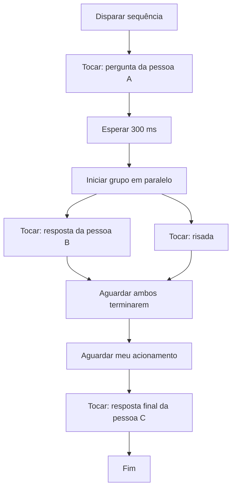

# Fluxos sonoros: diálogos e sequências sem alterar os originais

Plano de execução consolidado: [etapas, prioridades, dependências e validação](../plans/2026-10-29-evolucao-consolidada.md).

Data: 29/10/2026. Status: proposta de design; implementação não iniciada.

## Requisito confirmado

O usuário quer montar diálogos de piada com vários clipes, incluindo acionamentos em sequência e simultâneos, preservando os originais. O fluxo deve ser uma composição reutilizável, não uma edição destrutiva dos arquivos da biblioteca.

Nome de interface proposto: **Sequências**. Internamente, uma sequência é um fluxo de execução com referências a versões de clipes e configurações próprias. Pode aparecer como um botão na coleção, com ícone distinto de áudio simples e atalho próprio.

## Exemplo

O primeiro atalho inicia a sequência. Quando chega ao bloco de acionamento manual, o próximo toque avança. Durante uma fala, o mesmo atalho não inicia cópias acidentais nem acumula avanços antecipados. Reiniciar é uma ação explícita.

## Opções de implementação

| Alternativa | Vantagem | Limite |
|---|---|---|
| Renderizar tudo como um único arquivo | Playback simples e compartilhamento fácil | Não permite esperar pelo operador durante a execução; mudanças exigem nova renderização. |
| **Fluxo estruturado de blocos — recomendado** | Sequência, paralelismo e intervenção manual com referências preservadas | Requer executor, estados e controle de cancelamento. |
| Grafo livre de automação | Flexibilidade para condições, ciclos e integrações | Mais difícil de montar, validar e operar; além do necessário para os diálogos solicitados. |

A primeira versão usa blocos estruturados. Não exige desenhar fios entre dezenas de nós ou programar expressões.

## Blocos da primeira versão

### Tocar clipe

Referência a um clipe e à revisão escolhida de sua montagem. Permite intervalo e ganho próprios desta ocorrência, sem gravar esses ajustes no clipe de origem. O mesmo clipe pode ser usado várias vezes, com configurações diferentes.

Por padrão, a etapa avança quando essa reprodução termina naturalmente. O término se refere ao áudio efetivamente preparado para essa ocorrência, considerando cortes e processamento suportado. Não usar o campo de duração original como temporizador aproximado.

Efeitos como alteração de velocidade/tom, quando implementados no editor, podem ser reutilizados como ajustes locais. Eles não são pré-requisito para a primeira entrega de sequências.

### Esperar

Pausa em milissegundos entre etapas ou antes de um som dentro de um ramo paralelo. Zero é válido; valores negativos ou não finitos são rejeitados. A espera usa o relógio do executor e pode ser cancelada.

### Tocar em paralelo

Grupo com dois ou mais ramos. Cada ramo é uma lista de clipes e esperas. Todos começam a partir de uma referência temporal comum; uma espera no início de um ramo cria o atraso desejado.

Exemplo: um ramo toca uma trilha curta enquanto outro executa pergunta → pausa → resposta. O grupo termina quando **todos** os ramos terminam. A interface mostra qual ramo ainda está em execução.

Na primeira versão, não há grupos paralelos aninhados nem acionamento manual dentro de um ramo. O bloco manual fica entre etapas principais; isso mantém o significado de “avançar” inequívoco.

### Aguardar acionamento

Só avança com ação explícita quando o fluxo está neste estado. Usado para esperar uma resposta real na chamada ou escolher o momento da próxima piada. Disparos anteriores à chegada a esse bloco não ficam guardados.

O atalho global de parar continua independente e disponível.

## Interface de montagem e operação

- Criar sequência, dar nome e arrastar clipes da biblioteca para uma lista ordenada.
- Inserir espera e acionamento manual entre blocos.
- Agrupar blocos em paralelo, com ramos apresentados lado a lado e possibilidade de ajustar atrasos.
- Reordenar, duplicar e remover ocorrências sem alterar ou excluir clipes da biblioteca.
- Ouvir bloco, grupo ou sequência inteira no monitor. O destino da prévia deve estar explícito e aplicar-se a todos os ramos.
- Destacar bloco e ramos ativos, posição atual, próxima ação e estado “aguardando você”.
- Mostrar duração calculável e indicar espera manual separadamente; não apresentar uma duração total exata para um fluxo que depende do operador.
- Disponibilizar **Iniciar**, **Avançar**, **Parar sequência** e **Reiniciar**. Avançar só fica ativo na espera manual.
- Desfazer/refazer operações de montagem. A primeira versão não inclui pausa/retomada global em qualquer ponto, saltos arbitrários, ciclos infinitos ou condições programáveis.

Fluxos sempre têm começo e fim estruturais. A espera manual pode permanecer ativa até avanço ou cancelamento, sem manter processamento pesado ocupado.

## Preservação e referências

- Cada ocorrência aponta para o ID e a revisão do clipe/montagem, além de seus ajustes locais. Não copia destrutivamente o áudio nem edita a origem.
- A sequência fixa a revisão escolhida. Se o clipe for editado depois, mostrar “há uma versão nova” e permitir atualizar a referência explicitamente. A piada não muda de conteúdo ou duração silenciosamente.
- Iniciar congela uma versão do fluxo para aquela execução. Editar a sequência enquanto toca só afeta uma execução futura.
- Origens e renderizações necessárias permanecem disponíveis enquanto houver referências. Excluir um clipe usado exige informar as sequências afetadas; não apagar silenciosamente um arquivo ainda referenciado.
- Atualizar ou remover uma ocorrência não remove o clipe da biblioteca.
- “Salvar como áudio” pode ser uma evolução para fluxos totalmente automáticos. Para fluxos com acionamentos manuais, seria necessário gravar uma execução ou definir esperas; não há uma renderização única predeterminada.
- Compartilhar fluxos via pack exige formato versionado que inclua referências e dependências; não é pré-requisito desta primeira entrega.

## Integração com o motor atual

Evidência do código:

- `audio_engine.py:582` cria reproduções com `play_id`, callback de término e sessões independentes.
- `audio_engine.py:635` aplica a regra global de sobreposição e pode chamar `stop_all` ao iniciar um som.
- `audio_engine.py:659` encaminha callback de finalização; o contrato atual não expõe ao chamador um motivo estruturado de término.
- `main.py:504` inicia clipes com `on_finish=None` e retorna o identificador da reprodução.
- `main.py:616` para o áudio atual, mas não existe nesse caminho um executor de etapas futuras a cancelar.

Proposta técnica:

1. **Persistência do fluxo:** documento versionado de blocos, referências e ajustes locais. Reutilizar o armazenamento do app, com validação; não introduzir banco novo por esse recurso.
2. **Preparação:** resolver revisões, validar dependências e saídas, preparar áudio necessário ao grupo antes de dispará-lo. Se faltar uma referência, não começar uma sequência incompleta.
3. **Executor no backend:** manter estados de execução, identidade da execução e bloco atual. Não depender de temporizadores da UI ou da janela permanecer visível.
4. **Grupos de reprodução:** todas as sessões iniciadas pelo fluxo têm dono. Parar sequência cancela somente suas sessões e etapas; Stop All cancela também todos os fluxos e esperas antes de encerrar os sons.
5. **Concorrência:** o fluxo autoriza o paralelismo de seus ramos sem alterar a preferência global de sobreposição. Sons avulsos não podem encerrar ramos internos incidentalmente pela regra global. Isso exige adaptar a política de parada por grupo.
6. **Finalização:** distinguir término natural, cancelamento e erro. Cancelar um som não equivale a completar a etapa com sucesso e iniciar a próxima fala.
7. **Temporização:** preparar vozes simultâneas em lote e agendá-las com referência comum ao mixer. Duas chamadas independentes da UI não garantem início simultâneo. A sincronização é por saída; dispositivos físicos diferentes podem ter latências distintas.
8. **Eventos obsoletos:** callbacks de uma execução cancelada ou anterior não podem avançar uma nova execução. Usar identidade/revisão da execução e transições serializadas.

Primeira versão: uma sequência ativa por vez, além de sons avulsos. Iniciar outra enquanto há uma ativa informa o conflito; substituir é uma ação explícita que cancela a anterior. Múltiplos fluxos independentes podem ser avaliados depois.

## Erros e previsibilidade

- Dependência ausente ou saída indisponível na preparação: informar os itens e não iniciar.
- Falha durante uma etapa: interromper o fluxo e seus próprios ramos, indicando o ponto. Não pular silenciosamente uma fala e continuar uma piada incompleta.
- Stop All cancela esperas e acionamentos pendentes. Nenhum som pode reaparecer após a parada por callback ou temporizador atrasado.
- Não retomar automaticamente uma sequência após reiniciar o aplicativo. Restaurar a definição para edição, não a reprodução.
- Prévia e transmissão usam a mesma definição de fluxo e os mesmos ajustes, variando apenas os destinos permitidos.
- Fluxos não executam scripts, comandos externos ou chamadas de rede.

## Validação

- Ordem sequencial correta com durações efetivas, não estimativas do arquivo original.
- Início de ramos no mesmo ponto do mixer por saída; atrasos de ramo respeitados.
- Junção aguarda todos os ramos, inclusive quando um é muito mais longo.
- Clipe repetido no fluxo tem sessões distintas e não confunde callbacks.
- Acionamento manual só avança no estado correto; tecla mantida pressionada não atravessa várias etapas.
- Cancelar durante áudio, espera ou acionamento manual impede todo disparo futuro daquela execução.
- Callbacks atrasados não avançam um fluxo reiniciado.
- Falha de um ramo cancela os demais pertencentes ao fluxo, preservando sons externos.
- Stop All cancela sons avulsos, fluxo e etapas futuras.
- Alterar ganho/corte de uma ocorrência não modifica o original nem outra ocorrência.
- Editar o clipe de origem não muda a revisão fixada sem atualização explícita.
- Prévia não transmite ao cabo virtual. Validar com backend falso e depois em hardware real.
- Usar relógio controlável nos testes do executor e sinais sintéticos nos testes de alinhamento do mixer. Validar a experiência final com diálogos reais escolhidos pelo usuário.

## Ordem proposta

1. Consolidar referências/revisões da edição não destrutiva e o controle de reprodução por grupo.
2. Implementar executor sequencial com espera, finalização confiável e cancelamento.
3. Adicionar grupos paralelos e acionamento manual.
4. Integrar editor de blocos, botão de sequência, atalho e prévia completa.

O requisito é atendido quando sequência, paralelismo, acionamento e preservação de originais funcionarem juntos. Uma lista simples de reprodução, isoladamente, não cobre o pedido.

## Insights registrados

A ideia amplia a sequência manual de apresentações proposta anteriormente: agora há composição com paralelismo e pontos de interação. O elemento central é o fluxo controlar suas reproduções e dependências sem transformar o conteúdo original. É útil tanto para montar diálogos de piada quanto para preparar entradas sonoras de uma apresentação.
